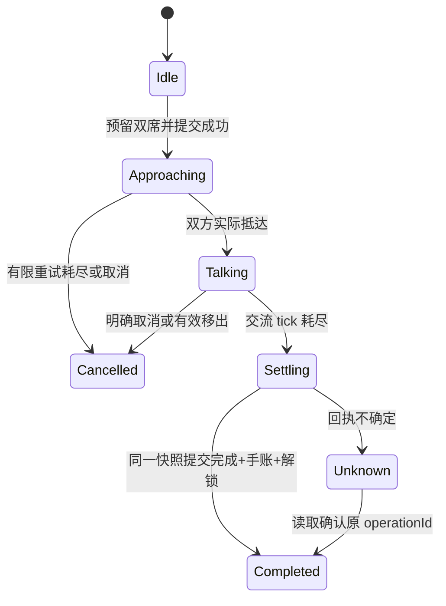

# AI 小院 0.4 状态与提交契约

2026-10-22：已接入正式 Host、ContentController、保存事务、四页 UI 和 frame v2。以 `src/core/content-state.ts`、`content-engine.ts` 和 `src/client/save-transaction.ts` 为可执行契约；验收见 [0.4 记录](V0_4_RESULTS_2026-10-22.md)。历史 M1/M2 的未接入状态不再代表当前源码。

## 1. 版本与权威状态

| 版本 | 值 | 含义 |
| --- | --- | --- |
| world schema | 4 | 首次包含事件、发现、手账、装饰 |
| scene version | 2 | 正式双座桌及移动后的坐垫 |
| simulationRulesVersion | 1 | 新事件规则、时钟和重试语义 |
| contentRevision | 1 | 文案及静态目录；不能借改文案重置事件 |
| event definitionVersion | 1 | `first-tea` 在途实例使用的定义版本 |
| frame protocol | 2 | 增加视口代次，继续使用 token/source/origin/sequence 校验 |

一个 profile 仍只有一个 `VillageRuntime` 世界 owner；React/DOM 页面、iframe、聊天会话切换都不是新的 owner。模拟只用固定 30Hz 世界 tick。选择页签、改主题、渲染动画不得消耗模拟 rng。

schema 4 在现有角色/意图模型上追加：

- `activeEvent`：至多 1 个 `TeaEventV1`，事件 UUID、定义版本、两名不同在场角色、食物、左右两席、阶段、交流剩余 tick、抵达期限、重试次数、分支。
- `progress`：`completedWishes`、`discovered`、`unlocked`、最近完成事件 ID。0.4 可写的心愿/奖励只有 `first-tea`/`wind-chime`；容量上限不授权任意 ID。
- `journal`：至多 32 条结构化事实，保存模板、参与者、食物、事件 ID、完成 tick、次数；正文由双语目录投影，不保存 HTML 或照片。
- `decorations`：`layoutRevision`、单件 `first-wind-chime` 和 `window|door|wall|null` 槽位。尚未解锁时物件为 null，解锁未摆放时 slot 为 null。

UI 草稿、`pending/unknown` 运输状态、临时气泡、DOM 焦点不入 world。落盘快照只能表示一次完整且已发布的事实，不把“奖励已发出、手账尚未写入”拆开。

## 2. 命令与茶会状态机

UI 命令只有意图，不直接更改 world：

| 命令 | 必须核验 |
| --- | --- |
| invite(participants, food) | 两名不同且在场、当前无事件、两席可同时预留、路线存在、owner 有效 |
| cancel-event(eventId) | 当前实例匹配；解除双方事件意图，不发奖励 |
| confirm-decoration(slot, expectedLayoutRevision) | 已提交的解锁、合法槽位、当前布局版本、profile/epoch 未变化 |

两席预留必须先在候选状态上全部验证；任一失败不改变任何角色。左右席顺序跟随 UI 选择顺序，便于复现，不能使用无序集合决定席位。

`Settling/Unknown` 是 runtime 提交状态；磁盘上的事件为 `approaching/talking` 或结算后的 null。结算候选包含 progress、journal、decorations；提交失败时不能先显示永久解锁。

规则 1 的交流时长 150 tick（5 秒），抵达期限 1080 tick（36 秒）。路径处理采用有上限的等待、错峰与重规划，不让一次短时碰撞直接吞掉心愿，也不无限等候。正式引擎使用圆形居民避障可视图、确定性顺序入座；其他居民等候，期限内允许路径重规划。候选路线最多 9 点；无可用路线时拒绝邀请，事件途中无法恢复则到期取消。

正式拖动语义：按下并不取消事件；拖动暂挂双方事件计时；取消/无效落点回到原事件；有效离席或移出角色才解除双方预留。正式 ContentController 已接通上述语义；在自己的预留座位放下仍保留事件。

分支固定为 `tea/rice/familiar`：食物首次分支由选择决定；已有共同经历时可以选择 familiar。首版一条首次手账与风铃只获得一次，后续同类交流可更新次数，不创建第二枚风铃。正式事件可重复。首篇手账保留首次事实与事件 ID，仅累计次数；progress.lastCompletedEventId 跟踪最近一次完成，因而重复完成后不要求它等于首篇的 eventId。当前目录只有 first-table，允许一篇；32 是未来内容容量预算。

## 3. 保存回执与不确定结果

`SaveReceipt` 采用判别联合：

| 状态 | UI 与运行行为 |
| --- | --- |
| pending(operationId) | 暂停关键玩法、显示确认中；不开始依赖奖励的新命令 |
| committed(operationId, profileId, epoch, revision) | 以匹配回执发布 committed view；只播放一次获得反馈 |
| rejected(operationId, reason) | 明确拒绝；保留原因，候选不能当作已保存世界 |
| unknown(operationId, reason) | 暂停写入；读取 state 对账，不能自动换 operationId 重发 |

延用当前 save 的 lease、epoch、expectedRevision、operationId。关键命令排在同一保存队列内；普通检查点不得跨越 unknown 关键提交继续写入。`flush()` 应返回可检查的终态，不再只吞掉错误或返回 void。

对账必须同时验证 profileId、epoch、operationId 和 revision。若 epoch 改变，先重新获得 owner 并重读权威世界；不把另一代响应认作本次提交成功。当前 Host 只识别 current 的 operationId，不承诺无限历史幂等记录。

游戏去重和传输去重独立：实例 ID、首次心愿完成标记和 reward ID 防止再次发奖；operationId 只识别这次发布。完成快照中 `activeEvent=null`、手账、解锁及 `lastCompletedEventId` 必须一起出现。

## 4. 旧档迁移与文件保护

已冻结真实隔离测试快照：`tests/fixtures/legacy/saved-schema{1,2,3}.json`，以及 `scene-v1.json`。manifest 给出原路径和原始字节 SHA-256。schema 1 样本没有 facing，本轮已修复该兼容缺口；schema 2/3 不接受缺失 facing。

正式版本已实现以下版本分发，替代“所有旧文件都用最新 scene 校验”的调用模式：

1. 安全读取、大小/链接/路径校验、指针和 hash 校验照旧。
2. 按快照自身 schema/scene 解码，未知版本拒绝，不当作新档。
3. 在内存纯迁移。保留 ticks/rng/userPaused/当前选择和全部在场角色 ID；旧 `eat/main` 映射到新 `eat/left`。未变家具尽量保持活动；变更路线重规划，不能沿用废弃坐标。
4. 安置冲突按稳定角色 ID 顺序在合法候选点寻找，检查障碍、可达与至少 24px 间距；失败时拒绝迁移而不是堆叠到 spawn。
5. 首次新保存前，以不可变受保护升级引用保留旧 current 指针和快照。之后才通过现有 CAS 原子发布新快照。
6. `read(current/previous)`、`save` 的前置读取、`recover`、`prune` 均通过同一历史解码入口。清理器按文件自身版本判断合法性；未知文件不回收。
7. 升级保护引用不计入最近 32 份的普通保留窗口。至少 40 次新保存后仍可读取旧字节；损坏保护引用导致停止清理，不能猜测后删除。

geometry probe 仅测试重安置可行性：它会取消所有旧意图，然后验证候选几何。它不是 M2 迁移器，不能直接投入生产，否则会无故丢失未受影响的活动进度。

## 5. Frame v2 与布局

已有 init/ready/render/dispose 和 pointer 的 source、opaque origin、token、单调 sequence 规则继续保留。初始化必须明确协商 version=2；不让 v1 frame 静默解释新消息。

新增 frame→parent `viewport`：`viewportRevision,width,height,world:{scale,x,y},dpr`。pointer 带对应 viewportRevision，旧代次消息丢弃。frame 只上报输入，tap 是否成立由 controller 在 pointerup 上按 5 CSS px 阈值判定，不新增 frame 的第二套选择逻辑。

正式气泡在 frame 内按 world 矩阵投影定位，不乘第二遍 DPR。初始化、资源内容和消息长度继续有界；`experiments/content-ui/contracts.ts` 保留样板字段说明，正式 v2 收发已接入 `client/frame-bridge.ts` 和 `frame/scene.ts`。

样板验证发现：背景 cover 而世界 contain 时，窗/门会相对世界锚点移动。正式版本约束场景框为 3:4，保留全幅背景，风铃与窗/门对齐；不能把裁剪后的背景坐标误当世界坐标。

正式宿主适配分开计算“允许展示”与“当前模式几何”：sidebar/主面板/Live2D 让位逻辑保留；展开不再被浮卡的 764px 宽门槛阻断。正式 owner 上的 800×600 展开交互已纳入浏览器验收。

## 6. 容量与资产门槛

类型定义给出 7 人、1 活跃事件、32 手账、64 发现/解锁 ID、ID≤64 UTF-8 字节、operationId 36 字节、路线≤9 点。必须在运行时验证这些约束；TypeScript 本身不是外部输入验证器。

`content-contract.spec.ts` 用七人最长路线及满容量结构分别测量 world、save request、Saved snapshot、state response；目标 world≤48KiB，各完整封装≤64KiB。这个结构上界样本包含未来占位目录 ID，证明容量余量，不证明内容目录有效。正式版本已增加外部 JSON 拒绝测试和有界、严格 UTF-8 响应读取。

样板沿用 130 张资源、0 张新增 PNG，风铃使用 SVG，茶点借用饭碗手型。以下保留原计划美术工单；最终交付调整为复用场景资源与代码矢量茶杯、风铃，不包含重新绘制整套家具或新增手型，具体差异与截图见 [0.4 记录](V0_4_RESULTS_2026-10-22.md)：

| 工单 | 输入与交付 | 验收 |
| --- | --- | --- |
| A04-01 双座桌 | 当前 204×68 世界单位几何、左右 anchor 175/273；单份桌前/后片 | 七人手部接触、桌边遮挡、角色正常比例；不能仅用横向拉伸当定稿 |
| A04-02 两类食物 | rice/tea 可区分道具及必要手型；按座位选择贴图 | 七人分别吃饭/茶点；不能两种选择显示同一饭碗 |
| A04-03 风铃 | window/door/wall 三挂点；当前 SVG 只用于定位 | 浮卡可辨识、不悬空；新 PNG 需生成来源、alpha、尺寸、hash 记录 |
| C04-01 台词 | tea/rice/familiar 三分支，七人问候/风铃反应，zh/en 文案键 | 不全员复用同一句；保存只存模板事实 |

0.4 新增纹理目标≤10、压缩 PNG 增量≤2MiB、解码增量≤8MiB；若手型超预算，先做资源复用/按需加载。frame bundle≤1200KiB、总初始化纹理≤160 的原边界不提高。

## 7. 已执行的分阶段验收范围

M2：真实 1/2/3→4、scene1→2；未知版本；当前位置/意图/身份保留；原字节不变；升级引用跨越回收窗口；current/previous 损坏；CAS 冲突；写快照/写指针前后失败；ACK 丢失；owner/epoch 切换；奖励/手账/布局同提交。

M3：42 个有序二人选择在固定七人稠密场景中的阻路结果；有界等待/错峰/重规划；取消和有效移出；两人到齐才计时；暂停无离线推进；同 seed/输入 tick 确定性；重复完成不重复解锁。

M4：接正式 owner，移除内存 sample 状态；两模式不重建 frame/owner；frame v2 的旧代次输入；主聊天焦点和草稿；中文/英文；布置 pending/unknown/rejected；重启后手账/风铃一致。

## 0.4 最终实施补充

- 设置单独使用 Preferences schema 1（主题、语言、减少动态、气泡），复用有界快照/CAS/不确定结果核对；不含奖励。设置写入和 acquire/release 使用同一 owner 事务锁。设置损坏时只提供设置恢复，不误恢复世界。
- frame v2 发布视口代次与舞台投影，父端拒绝旧代次指针；气泡在 frame 内使用同一投影，最多两条，并在详情提供完整文本。
- 茶杯和风铃采用代码矢量图形，运行纹理增量为零。界面以固定 3:4 舞台放入展开区，背景与挂点保持同一比例。
- 两种界面共用 owner 和 iframe。React 常态约 2Hz 更新，场景仍使用父端 30Hz 时钟；关闭和暂停不持续渲染。
