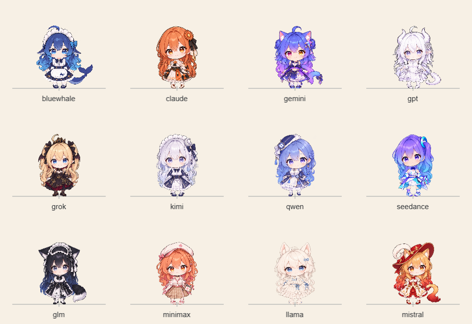
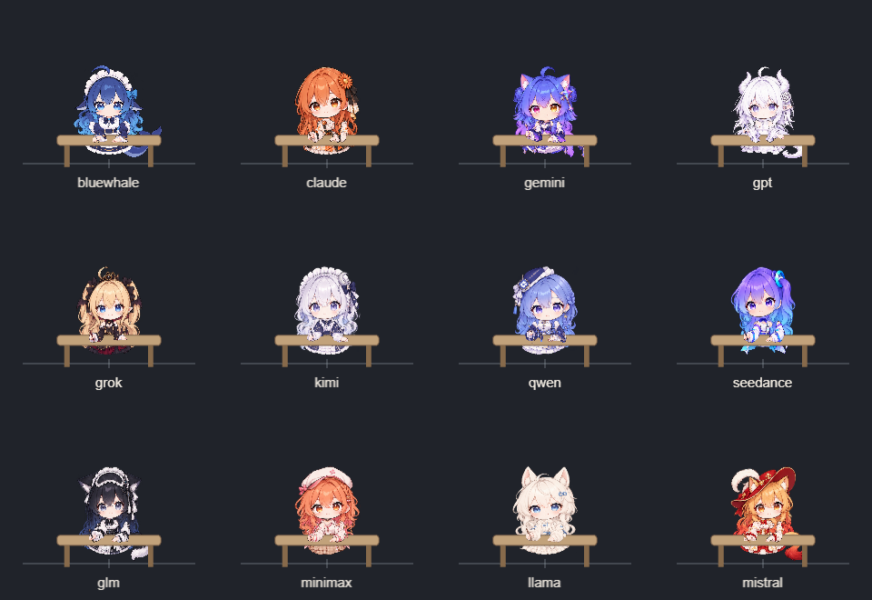
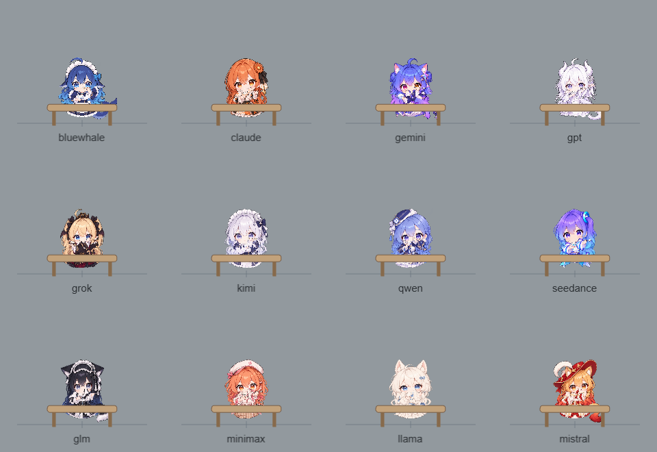
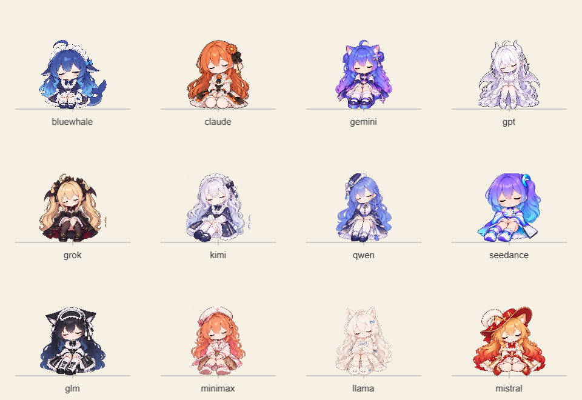
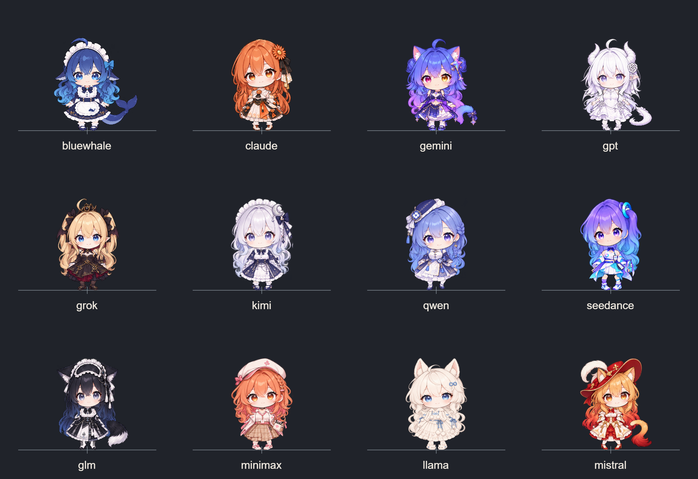

# 十二居民视觉基线 · 2026-10-24

本目录建立固定的 4 × 3 全名册对照，直接读取当前生产 `assets/characters` 原图，使用生产 `PaperDoll` 和 `samplePose`。不改原图、不修改 manifest 批准状态、不写入任何 profile。

运行 `node scripts/ai-village-v011-visual-baseline.mjs` 可重新生成本基线。独立网页位于忽略的 `.build/ai-village-v011-visual-baseline/index.html`，运行时无需联网。蓝鲸的五张工作/用餐/坐姿图按当前生产路径从 `assets/scenes/courtyard` 读取，其余角色从自己的 `parts` 读取。

## 矩阵与结果

- 十二居民，201 张唯一生产 PNG，共 37,456,809 bytes，逐张 SHA-256 与当前资源 manifest 一致。
- idle/work/eat/rest × neutral/light/dark × 96/108/128 CSS px × DPR 1/2 = 72 张截图、864 个角色姿态。
- 相同采样时刻 0.4 秒，待机/工作/用餐统一 neutral 表情；休息使用角色现有完整闭眼坐姿图。
- 截图宽高：DPR 1 为 960 × 660，DPR 2 为 1920 × 1320；图片总量 33,638,132 bytes。
- 严格 TypeScript 检查、构建和截图矩阵通过；外网请求 0、浏览器错误 0、ticker 未启动。
- 每格有同一脚底横线/十字。十二骨架均使用 `[512,952]` 脚点与 900 设计高度；108 CSS px 的可见容器高度约 107.43–108.26，蓝鲸尾巴和部分居民尾饰自然更宽，不作强制等宽。

`validation.json` 保存原始尺寸、透明/不透明/部分透明像素数、边缘非零 alpha 数、原始 alpha 非零边界、定义与实现哈希、每张截图哈希、每个角色每次的屏幕脚点和容器边界。边缘非零像素包含低 alpha 抗锯齿，单独出现不代表裁切缺陷，不将该计数当成美术批准标准。

## 目视发现和范围

人工式逐图检查了下方五张代表性总览（每张含十二人）：待机浅色 128、工作深色 108、用餐中性 96、休息浅色 128、待机深色 128/DPR 2。角色足点对齐，三种底色下整体轮廓可辨。Llama 与 GPT 的浅服装在浅色底下对比度低于深色底，保留现有配色供后续美术评审。

发现 **Grok 现有休息图右侧有一小段独立残片**：`assets/characters/grok/parts/rest-pose.png`，SHA-256 `449b1f27529f23fbecace10cd2569e749d806ff6cf91985e059fd9bb01c478c2`。在休息总览第二行首格右侧可见；进一步查看原 PNG 后确认残片来自原图。未裁切、修图或隐去证据，建议单独修复候选并重验。

这是确定性 QA 基线，**不是全部 72 张的人工签收，也不替代真实家具遮挡、行走动画、正式书屋或正常 GPU 性能验收**。工作/用餐使用中性桌面遮挡示意，并复用生产手臂尺寸和坐标；不声称它是实际家具截图。Chromium 允许软件渲染，此结果不证明正常 GPU 性能。

